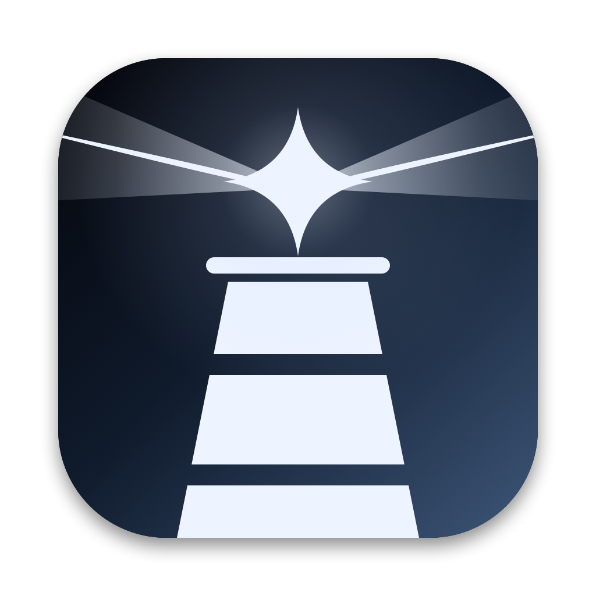

<p align="center">
  
</p>

<h1 align="center">Faro</h1>

<p align="center">
  A personal "swiss-army knife" for macOS: local voice dictation, meeting notes, and a dynamic island in the notch.
</p>

> **Nota en español:** Faro es un proyecto personal de Daniel León. La interfaz y los comentarios del código están
> en español, y la transcripción está pensada para dictar en español. Este README está en inglés para que más gente
> pueda usarlo; los issues y PRs en español son bienvenidos.

---

## What it is

Faro is a menu-bar app for macOS written in Swift and SwiftUI. It started as a dictation tool and grew into the
small set of utilities its author uses every day. It is a **personal project**: it works well on the author's Mac,
it is opinionated, and it is shared as-is in case it is useful to someone else.

## Features

### Dictation
- Hold **Fn** to talk, release to paste. Double-tap Fn for hands-free mode.
- Speech is transcribed **locally** with [whisper.cpp](https://github.com/ggerganov/whisper.cpp)
  (`large-v3-turbo`, quantized), split at natural pauses while you are still talking so the result is ready
  quickly after you release the key.
- The raw transcript is cleaned up by **Claude Haiku** (filler words, self-corrections, punctuation, lists),
  with a tone that adapts to the app you are typing in (formal in email, literal in code editors and terminals,
  casual in chat apps).
- A personal dictionary biases Whisper and the cleanup toward the names and terms you use.
- The text is inserted at the cursor in any app, adjusting capitalization and spacing to the surrounding text,
  and your clipboard is restored afterwards.
- **Local-only mode**: skip the cleanup and never send anything to the network.
- History of recent dictations.

### Meetings
- Record a meeting from the microphone, optionally mixed with the Mac's system audio (Meet, Zoom, Teams).
- Live, local transcription with timestamps, saved as it goes so a crash does not lose the transcript.
- Summary with key points, decisions, tasks and open questions, generated by Claude Haiku from the transcript.
- Import existing audio files to transcribe them.
- Optional **live copilot**: point it at a folder of your own Markdown notes (your product, your services, your
  projects) and, when someone asks a question those notes cover, a short answer appears in a floating panel that
  is excluded from screen sharing. It only answers from your notes. The folder is set in
  *Ajustes > Copiloto de reuniones* (default `~/Documents/Faro/Notas`; empty disables the copilot).

### Dynamic island (in the notch)
- **Now playing**: track, artwork and playback controls for Spotify, Music, browsers and more.
- **Claude Code**: plan usage and rate limits (5-hour and weekly windows), cost per day and per project, and
  which agent sessions are working or waiting for you. Faro connects through a Claude Code `statusLine` command
  and hooks in `~/.claude/settings.json`, installed from the app when you choose to connect it; an existing status
  line is chained instead of replaced.
- Volume and brightness indicators in place of the macOS ones.

### Tools
- Keyboard cleaning mode: blocks every key for 60 seconds.
- Homebrew: see outdated packages and update them.
- Per-app volume mixer, external monitor brightness over DDC/CI, and independent scroll direction for mouse and
  trackpad.

## Screenshots

There are no screenshots in the repository yet. The app icon above is the only image asset.

## Requirements

- **macOS 14.4 or later** on **Apple Silicon** (Whisper runs locally and needs the Apple GPU to be fast).
  A Mac with a notch is recommended for the island.
- **Swift 6 toolchain**: Xcode or the Command Line Tools (`xcode-select --install`).
- **whisper.cpp** from Homebrew (Faro looks for `/opt/homebrew/bin/whisper-server`):
  ```sh
  brew install whisper-cpp
  ```
- **The Whisper model** (about 550 MB), downloaded once to Faro's data folder:
  ```sh
  mkdir -p ~/Library/Application\ Support/Faro/models
  curl -L -o ~/Library/Application\ Support/Faro/models/ggml-large-v3-turbo-q5_0.bin \
    https://huggingface.co/ggerganov/whisper.cpp/resolve/main/ggml-large-v3-turbo-q5_0.bin
  ```
- **An Anthropic API key** for the cleanup, summaries and copilot (optional: dictation works in local-only mode
  without it). Paste it in *Ajustes > Limpieza con Claude*; it is stored in the macOS **Keychain** (service
  `dicta-anthropic`), never in a file.
- macOS permissions, granted from the app's settings: Microphone, Accessibility (to paste and read the text around
  the cursor), Input Monitoring (for the Fn key), and Screen & System Audio Recording (only for meetings with
  system audio and the per-app volume mixer).

## Building

```sh
git clone https://github.com/daniellelooo/faro.git
cd faro

# Optional, once: create a self-signed code-signing identity ("Dicta Dev") in your login keychain,
# so macOS keeps the permissions you granted when you rebuild.
./scripts/crear-certificado.sh

# Build in release mode, assemble dist/Faro.app, sign it and install it to /Applications.
./scripts/build-app.sh
```

`build-app.sh` **replaces `/Applications/Faro.app`** and restarts Faro (it refuses to do so while a meeting is
being recorded). The bundle identifier is taken from `FARO_BUNDLE_ID`, otherwise from the copy already installed,
otherwise `com.daniellelooo.faro`.

Other scripts:

| Script | What it does |
|---|---|
| `scripts/test.sh` | Runs the test suite (`swift test` with the paths Swift Testing needs under the Command Line Tools). |
| `scripts/bench.sh` | Dictation benchmark: synthesizes 70 Spanish phrases with the system voices and measures word error rate and latency through the full pipeline. Results in `docs/bench.md`. |
| `scripts/make-icns.sh` | Rebuilds `Resources/AppIcon.icns`. |

For development, `swift build` and `swift run Faro` also work.

### Tests

```sh
./scripts/test.sh
```

Tests that call the real Anthropic API run only when `ANTHROPIC_API_KEY` is set; `scripts/test.sh` reads it from
the Keychain if you saved one in Faro, and otherwise those tests are skipped. Some tests use the local Whisper
model and `whisper-server`.

## Privacy

- **Audio never leaves your Mac.** Recording and transcription happen locally with whisper.cpp.
- **Only text goes to Claude**: the transcript, plus (for dictation) the text right around the cursor, the app name
  and the window title, so the cleanup can match the context. For meeting summaries, the transcript; for the copilot, the
  last minute of the transcript and your notes.
- **Local-only mode** turns all of that off.
- Recordings, transcripts and history are stored in `~/Library/Application Support/Faro`.
- There is no analytics and no server of its own: Faro's only network calls are to the Anthropic API (the
  Homebrew tool runs `brew`, which talks to Homebrew's servers, only when you use it).

## Notes and caveats

- **MediaRemote is a private Apple framework.** "Now playing" uses it, loaded at runtime with `dlopen`. Since
  macOS 15.4 it only answers platform binaries, so Faro loads a small adapter (`NowPlaying/`) inside
  `/usr/bin/perl`. This can break with any macOS update and is the reason Faro cannot be distributed through the
  Mac App Store.
- The app is not notarized. Built locally it runs fine; a downloaded build would need to be allowed in
  *System Settings > Privacy & Security*.
- The UI is in Spanish and the dictation is tuned for Spanish.
- This is a personal project: issues and pull requests are welcome, but there is no roadmap or support promise.

## License

[MIT](LICENSE) © 2026 Daniel León
